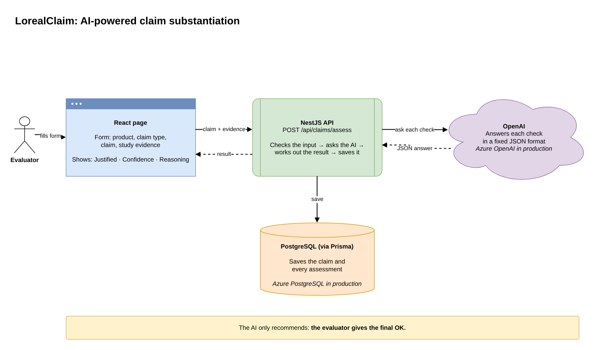
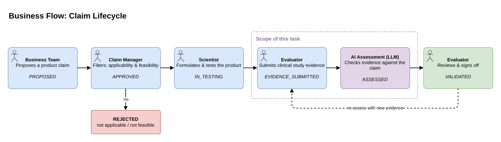
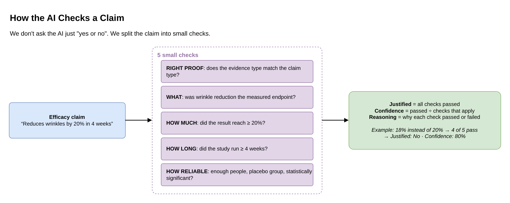
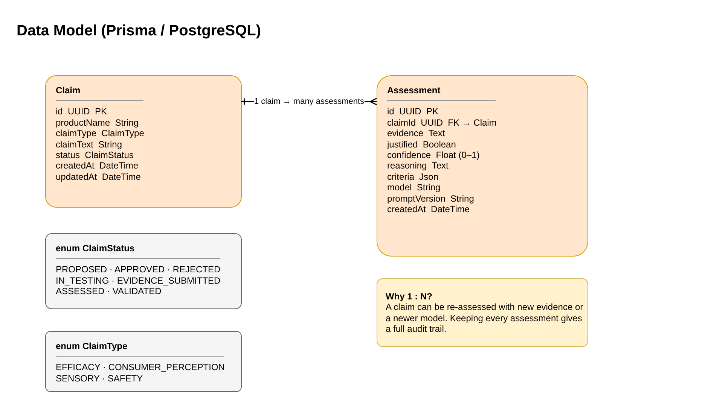
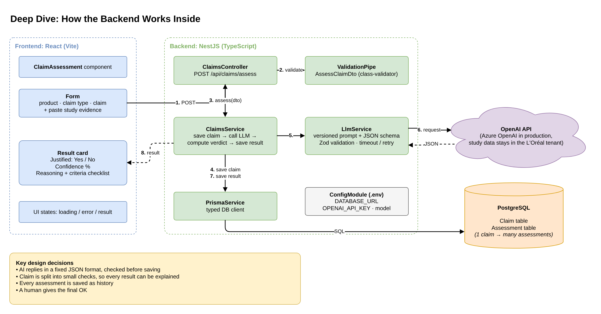

# LorealClaim: Does the study prove the claim?

*The core feature of the L'Oréal Claims Intelligence Engine.*

## 1. Project Overview

LorealClaim is an AI-powered application
designed to evaluate whether scientific study results support a
proposed cosmetic product claim.

The objective is to connect product claims with scientific evidence
and generate a structured assessment using a Large Language Model (LLM).

The system will allow an evaluator to submit clinical study evidence
against a proposed product claim. The backend will process the claim
and evidence, use an LLM to generate an assessment, store the result
in the database, and return the assessment to the React frontend.

The assessment will include:

- Whether the evidence supports the claim (Yes/No)
- An AI-generated confidence score
- A reasoning summary explaining the assessment

The AI assessment is intended to support scientific review. It will
not replace expert evaluation or regulatory approval.

---

## 2. My Understanding of the Business Problem

Cosmetic product claims must be supported by appropriate scientific
evidence before they can be used confidently in product communication.

For example, a product team might propose the following claim:

"Reduces wrinkles by 20% in 4 weeks."

However, proposing a claim does not automatically mean that the
claim is scientifically justified.

The product must undergo formulation development and evaluation.
The evaluator conducts or reviews a clinical study and submits
the resulting evidence.

The system must compare the proposed claim with the submitted
evidence and determine whether the evidence supports the claim.

The challenge is to build a system that:

1. Accepts a proposed product claim.
2. Accepts scientific evidence associated with that claim.
3. Uses an LLM to assess the relationship between the claim and
   the evidence.
4. Produces a structured assessment with reasoning.
5. Persists the assessment in a database.
6. Returns the result to the frontend for display.

The system should also account for incomplete evidence, uncertainty,
and limitations in the submitted study.

Research behind this understanding: cosmetic claim regulation, types of evidence, study credibility and safe use of LLMs: **[docs/research.md](docs/research.md)**.

---

## 3. Business Workflow

### Step 1: Business Team Proposes a Claim

The business team proposes a product and its intended claim.

Example:

- Product: Anti-ageing cream
- Proposed claim: Reduces wrinkles by 20% in 4 weeks

The claim is submitted for review.

### Step 2: Claim Manager Reviews the Claim

The claim manager evaluates whether the proposed claim is applicable
and feasible.

The claim may proceed to formulation and testing if it passes
the required review.

### Step 3: Scientist Develops and Submits the Formulation

The R&I scientist develops the product formulation and submits it
for evaluation.

The formulation is associated with the proposed product claim.

### Step 4: Evaluator Submits Clinical Study Evidence

The evaluator conducts or reviews the relevant clinical study and
submits the results.

Example evidence:

- Study duration: 4 weeks
- Number of participants: 100
- Reported average wrinkle reduction: 18%

These values are illustrative and do not represent an actual
clinical study.

### Step 5: AI-Assisted Claim Assessment

The backend retrieves the proposed claim and processes the
submitted evidence.

The evidence and claim are sent to an LLM for structured analysis.

The model returns:

- Justification status
- Confidence score
- Reasoning
- Any relevant limitations identified

The backend validates the response and saves the assessment
in the database.

The saved result is returned to the React frontend.

Example output:

- Claim: Reduces wrinkles by 20% in 4 weeks
- Reported result: 18% average wrinkle reduction
- Preliminary assessment: The reported result does not meet
  the claimed 20% threshold.
- Confidence score: Illustrative only
- Additional review: Study methodology and statistical
  uncertainty must be evaluated.

The final assessment must consider the study design, measurement
methodology, population, statistical uncertainty, and other
relevant scientific factors.

An LLM-generated result is decision support, not definitive
scientific or regulatory approval.

---

## 4. Proposed Technical Stack

| Layer | Technology | Responsibility |
|---|---|---|
| Frontend | React.js | Submit evidence and display assessment results |
| Backend | NestJS | Handle API requests and business logic |
| Language | TypeScript | Type safety across frontend and backend |
| Database | PostgreSQL | Store claims and assessments |
| ORM | Prisma | Database models, queries, and migrations |
| AI Integration | OpenAI API | Generate structured claim assessments |
| API | REST | Communication between frontend and backend |

Why each choice was made, the alternatives considered and the trade-offs: **[docs/architecture-decisions.md](docs/architecture-decisions.md)**.

---

## 5. Initial Scope

The first version will focus on the core assessment workflow.

It will support:

- Submitting a claim and associated evidence for assessment
- Validating incoming requests
- Saving the claim (product, claim type, claim text) in the database
- Calling the OpenAI API
- Validating the AI-generated response
- Persisting assessment results
- Returning the result to the frontend
- Displaying the justification status, confidence score,
  and reasoning

The initial version will use text-based evidence input.
Document uploads, advanced workflow management, and other
enterprise features can be introduced in future iterations.

---

## 6. High-Level Architecture

The application will use a React frontend, a NestJS backend,
PostgreSQL with Prisma, and the OpenAI API.

The frontend sends the product name, claim type, claim text and evidence to the backend.

The backend validates the request, saves the claim, and
coordinates the AI assessment.

The generated assessment is validated and stored in the database
before the saved result is returned to the frontend.

### Architecture Diagrams

Click a link to open that diagram in draw.io in your browser. No sign-in or install needed.
Source file for editing: [`docs/architecture.drawio`](docs/architecture.drawio)

1. **Simple Overview**: [Open in draw.io][page1]

   

2. **Business Flow**: [Open in draw.io][page2]

   

3. **How the AI Checks a Claim**: [Open in draw.io][page3]

   

4. **Data Model**: [Open in draw.io][page4]

   

5. **Deep Dive: Backend**: [Open in draw.io][page5]

   

<!-- draw.io links: each one opens a single page of docs/architecture.drawio -->
[page1]: https://app.diagrams.net/?lightbox=1#R5ZpRc6M2EIB%2FDTPtiweDje1H2xe3l6aXtL6Z3j3KSIAmAnmEsJ379V0JAcLYCZeO67qXyQNaLSuh%2FXbRyjj%2BMj1ElBHHcxOeS8f%2F4Hge2m4HmKJYoDQfZESCyPHvHH9phKBMcanKd0TsKNkrFc%2FNUEpK%2BXAAzTVNt9r0o6UFhtw5yJp%2FNYdfBNomv3NMGEjwwRjx%2FUlpGL%2BUkmDil4JYVDMYNoI1%2FVYN7xppQTHJW4qScybpti0MeZaRULZkSAi%2Bb6tFnLVH3aKYdATrELGu9C%2BKZVI9l%2Bs2Hb8SGidm6ElgOlJUKRtBniDM95aou47VagrO5dnuZsmXhDHLk2Ycx1t9%2F731YwqSyX9uTnbNmRFy%2BVItrSQH6FskMmUgGMIlYjTO4JqRSPUAc5KCK%2BZGnFKM1c2LiGfSoKLGL9vGsLJTDrVDrDBDPXBBEFsyRFPHV0%2FygQNUgFJC9JwKwBOmKyAYamlYaq%2BMMZgLOViP8vqaWHFBeEqkUPYTi5ORWd59A9WsYurQVnlpRwQyRMe14b5uAh3jqe92aJET0cenAPlWXRYpm4eSC8uLD2hD2BPPqaRceXPDpeTpCTdLvm1j8aZ779Q1UsNdxFeTrq9Gr7rKG46v6CtAPewVgIIXGSbYrOo%2BoZKstyhUvXvI5kdOoIwtOVMuhXt9jMg0CkGeS8GfidUThFOyidpROvRUdIvQNKfQagZ3T7nU8QKmcsAGfBrEUqsYSSX4s3zOMoWbTli2TecGcV6y4sJkBAh%2BXCh7yzr2IRO8AM1KcnyfUVha2YPs4E2VhaTPsOtEv5jUuPdFLmlEYSXAm0vPWcAL013yLKqsNVJ44JxnNIsvg%2Flw3OXcG7dBHx4npek1s9IGiRvj%2FOgNl8M0wJ8PuqXVLWOz7mxaY1rySP%2B9OstuhN15zmziTFdqcU9fX4Iy79YgQ1t6ccjGZIpHp9w39TZ%2BELwJWfXahSQWkjxXuQaFz7Ge02MhGc2qd2de3uQO3ODVtFtlqk8kl%2FdrUJo%2FfeyXZJ8e159Lr%2BiVW%2BlUmatmnqu59UiPy4SEz83%2BjGbbQhoyp4EzK1GwFOYf273H9vZcaG2uzZT3CJIX7NhqjnZ6X0jl9VLs2P1P0X9x%2BMkQ8J%2Bcgn8GxSLqD3%2FIeIF7Qf24Jdm8J87zLN8ToaCA7Uai9gYKzq4ezZSLVIlJD%2Fplfr9%2B%2FKQrTgGl4HnqaT3Qt0LoUttMztUWzbZEbZmb6dLGyEUonZ6gdNamdBocURpcc8uLN5emNIpIEJ7cB%2BDJbOO6%2FSl9gWyMifAVDeWEHjbVoG9k7eGoF95QZMlYkPUfD6D4044qKp8EzVP083v3yWuTGO3SGHyd4a4qARxfNAgq3afKHz0GOBsOrYe5XkicqNfrrUyVuKuqz4TEyLtm4uaGf4I7B1zdGOGFCMlxpW9FjjJSVeBcyITHPEPsrpEu2rF1XLwbfFWbqWOARc35qU0syfBcHd2pQwLGIdlq0YqyymYZg9V53HAwrv0ukYiJ7NTBVrSouM5NXn4nGIIwJOmuvazXcbL3PidbS3NbXiYHKr%2BYfnX9Ve9lR%2FpeWPQvpszSjaavy0a9qbfIqLKa4y1a5fytM%2BK%2Fj5F6iW6LEIzypB6%2FwsVt4TLxbF6GbV50Z99kUhURt47I6IdCpE8SKetjO4%2FU0DwRQcE3RLTOLlvZpZtcoF7tlBC3Ts34ndT8j%2FLKwJ22IAo80zyG5Fy6CXq%2Fnkw9iXQ9evvwBD9kynHr1lebBaurRuMkGFWha3GhzqxuHgeoxdnlS%2FjIO1PCB5tg%2FPZBU2fpPzenjzxj5YqGPIWaF5tfdzq1eVlAk%2BYHSzemdmkdUUBXnQL9Njhdq1%2Fkx%2Bhx98fo2etn8oH7LxS3WufMxxDmfuuzE1tH91Yfu%2BgvX7S2%2FlDGv%2Fsb
[page2]: https://app.diagrams.net/?lightbox=1#R7Vpbc6M2FP41nmkfmuFiMHn0LVt3nGwmuGn3aUeGA6gRyCPk2N5fX0mAAeMkjhM3rBtPJoPOObqg79MnCaljDuN1gAl0DC2iKe%2BYo45hoMXiwscoZChOLxLgwtQxxx1zmBtFMPaz0IDQlXQbWoJiyGzGhUgOlilOIE3F41UeI4rQ%2BiJd%2FsnavzC0iK6pD0RY%2FHVWhG7Ydlasv8kstulkhpAVdeulwcU%2F8sp1LbcusQ9pLZBTSjhe1I0eTRLweM2GGKOrelhASb3WBQqhYXA9RJrWv7DPo9xqalrp%2BB1wGOVV9%2BzcEaMiODekEfJFB5amZj8Wvcko5U%2B6yy4fAiEVDPN6OsbV6%2FNuX5NBwt9eHG8Wl9eQ8k3RtRzWwjeIeEyEQRePiOAwEc8EAul5BMaxgKKfm2Ps%2BzLzIKAJz6ki68%2FSecGynKyqR0SWeVW7LDbl2wwJwnIMTHEA3saTg0dlE7XCutLo59%2B%2BMgKAxsDZRo7BCiO6eUeuSvpcFuxZ10M2de6jnLvhtuBDARExOSavhi716AIOgY%2FRZeKDn3f5KsIc3AXypHcltKCOrNAmMqSEMpXXBN23oCfsKWf0ASqeS7tnIruOsW5IbjAvTzo75SU0kaTwURptm7NLHU4XTX6lork4CacqNdK10jST4aPuHmpVm2Xm6X3NL5tr7iOkm%2FWyRgMpaBGWzOQofTgNBfVek4Ndo85B27JqJOx9JAnn%2BqkZ6CNwAm8fA23PgXnwIgMbkHYMm0hWzcVDKB8qojMDOdtmftEt25BtHlZYbhld0BRkJiQ7gFF%2FKaY1McFlarUb%2F7QFb4u8%2B3r71R2PKg3AZfBJ%2BKZZDb7pPetZzftQ0ZsbZ8C3Yj67RolYlLDD%2BHaFCQeWZjOiWDASoZpzTDDfqN6yUayEU%2F2X6ydAKS78R3CxfyvYeN82LhpWm8gIOfPAbyxNm%2BykS%2BZBXTQrjJVFFLMXZTyiIU0QGZfWQZ3TVf5W2CjTBM2BDJD3EKosFQIH6idCIPH7csktzHNCvYfMJBhWlJlxv1hH6xfWFnWOWAi8PhhrXD%2BKBwwI4vix3osfIzDmGQiM62HReCy2l4dJC2XxUgCgJrOmlAg7V8ueCKoT3RGiMrn5Phu7s8nNl5ZNcXarZMU4UlaMM5EV8wxlpXsGsjKWTsTpgSsWdzmPsVIOj%2BBEbvLU2y59CQ08Yh8S8WrH6Mj4fjIa3wzH390%2FB9eT2axtyxS71yo9MY%2FUE%2FNM9KR7hnpitf7Lz8t60p%2BIgH4qNtFpLN%2FC0H6ZTq9%2FPUxdhhF4D2lNSTQUIpzIVU%2B%2BVjl%2BK9533bHbuq2447RKV7pH6kr3THTFOkNdsU%2B%2BTrHA8bv7dMURM45t%2F%2FfrlDuhILDav%2FdJcZik6vNvcJSO3Penk1G%2FdQsUXbtslZJYRyqJdSZKYp%2BfkmDvsLOBNEIL%2BbiMSd%2BTY7Y8E5pKAG5pijmm8jRoTjmn8ZOHRrtQVg%2BD6hq0xa%2BhQdlvv8qcYrAaTnOs2vVvE87OQHU%2BFlTjE9S3g2pYLUPV%2FET1HYaq3TJUu5%2Bovh1Vu9cyVO1PVN%2BOqlgBtwlWBv%2BceuMVOB54ez8Qzx2ra2nvsPG6G%2F8xHtY3O8%2FsuxLKK0fZ6kqk7GVDyxzZCfapLnvZ2qsPmz%2F2po28J%2FB%2FPhXajpAKARP602%2BTCBUiexyw9s8IbO3yH6wx%2F1s8a8olU98KTyIAqLhk8lvt0ugLX%2FgZ%2FIbUl2U1xkUDhKzAqva5%2BLTMOaTsogbRjWhTKWdBcSIPzl5TStnaW5m7MtPpvd5F%2FcqgYVuHkvugKnrWO9WghlLWG4dho0beFp63j1MV88St7qK28v58NUZ5i%2Fv66vK%2BilZ3%2Fc3xvw%3D%3D
[page3]: https://app.diagrams.net/?lightbox=1#R7Zltc6M2EIB%2FDV8zgGyCP9qOE6eTu3SSdPJZRgJUC0RBxHF%2FfVdCvBm%2F3fV6vkyTyXjEarVadh9WQlhonryHjFPLtWNRSAvdWK6Ls%2ByKMBzlOCmuUipBZKGFheZGCMqMVKpBTIN1oRRcO8UJraToCi6XYgO%2FMla2p%2FfwMze6NlYXHLPEGLanIGj%2FlU93Oc7iL4JQDhLyXpl1RrZdTUW2lWRSC6K89shpBc%2Fsb%2BOQU6uVjNCipyiF4JJlfWEg0pQGsifDeS42fbVQ8P6sGY7oQPAcYD6UvjIiYyNF9W2ojiVlUWymvvZMR4JrZSMoYkwgwK1oGMc6mrkQ8mB3G%2FI55byTWTOP5d5%2B%2B9jmNnOayn9vTlZj3zAvTRzPZAvCJLd17CV9B19msUw4CBxoYs6iFNqchqrnjeaSQa6mRpwwQtTgWShSaVhSDlbXxrCyY9yD4fT9YACcY0ka4E9FQmW%2BhWtjcWQCuO0DvWkpap6FuANQPQwbcKPG8LnZAB2TkG%2FPmztI3KvKGBGp5XqWi9AEoie1e%2Bt%2BPv8sC6kNe3%2BVit7ZlqrsilzVGdGKVaHRNouMM9nYCCoCbJZKoToTrB2rqtXVf4OGM9qDRvfavgwq4yEqjr2PFXRJVoL2me3gAonmKv4raESqsQhDyEOwbXNcKcDMjU4zKG8kC9fybWsyf6KkDDRJm5yla66bK2VNOTbWxMDPSClQCgXFDLwZIJOLMiWUmDRvYibpc4YD1buBtatPE6ywfC440KvGIoKpHwYgL2Qu1rTT4wU%2BXYU7XLmKxzwwl%2F5lKGoqeAcj19tDkX9JiqIgXg8gGg8qwA%2FNJnXImF7vy%2BbEu0bYO5nNrr1UpKqsEFzEjTu7xUeKbFihCnCXpdGDvrpx7Fb0otRvDhYn4xYy1%2Fvcb91FPwk%2B5PXpm4wH8CF%2FXwm7bA2zTxewp%2Fu75Qvo%2FP70%2BHi7t3qhqV4idWmqVjP6BrvWNFBNuc1otR0M4sFqpzvR7a9F92lOfwpQ%2Fs7%2Byd1D1GgPUeOLAuWcBup1OX05zNEGdxY7aOVqAZRMbcAMPAnFRQlixVlKMsFUxD8ZOochH30EhtzTDC0fX0Hjyx%2Fz5ZGKxEjDTE6LkkvdwLoO6X3SxJqOm53UJ0LnIOSOnI%2BAEDoXoYfHr3fnIVTIkqjA5GW6w0%2B7%2Bf5k6CyGJpOPwNDoXIaeFg%2F309nD4jBHNBVlpMpORkWmlrW5anPAYCX00Z8os0pYSCxZoXfPXIWwgAQy9Qb5ucidSRcaX38AuiAmhAXyNGK%2FlUBDyNR2Z9%2FBga2H2f13RQhvUbQjOscKu9bnIg3rrfoR87U925oja3bdnUrGWJ%2BHZZni9eSET7B5EylgcnS%2BTawSbJZqPVXXCX2mFmLGj97iQMKaI5l3nKinUD%2Bajl8foxSSYm0%2B7Jyu6DrvWRPX1HndOTbeHDi3Mept5vREX4WOn1vFrxN43etX8zUxYa33P%2FIcZ0x9Mtr3yPvuCnneL3GO49s7u9bJmW8%2BzkXfpdU53OBh3skdJRGtzzNELmMRiRTzRSud9bPbzWQnL%2Bqa4xXlMxysIz2kk8pQ%2F4EKvB1N1ScgEK%2B4gGdIi24Zr21WFNTfdZyrcZNh5ejx%2FMJ9iTIP6OAwVOI8orJ%2FuvUdMOSUw0r41vfiIokVpfwfZ7Y9oOwmtrN8fYTcap0DXxXN%2BM73266O7q2%2FIutPylpbf4FGi38A
[page4]: https://app.diagrams.net/?lightbox=1#R7Vhtb5s6FP41SNuHW%2FHS0OQjIWTL2qZZSLv1U%2BWAA14NRsY0zf311zYmgUDadKsa6WptpeLnvBn7OccHa5abPK8QhpqpxyRnmjXSTBNk2VmIQERBkp%2BlkHFIszzNchXIlVFYqoaAASE29RQksMTOz%2FhwJAX6NQkhVva6w4Hdnwj9hYIsVjp6%2BFzaG%2Be6XvoMNyUyqICIVoGNHeCjf1Vko1IrUAjzhiIjBDOUNcGApCkMWAMDlJJ1U21FcDNqBiLYAvwA4Db6A4UsVqhVvYYQfIUoilXoC1sJElApKyCPQUjWNai9jtVqUkLYQfFuyV2IcW0DVRzNHL%2FddvuaFKbsz92x0vYJ4EKtY5NE%2BqcZRXkClH9Tn3HGRhT6368%2Bq9Vim2oLGHzmUxrGLMEcMPgjwChK%2BTOGKyF5gpQhvmWOghMUhsJ4uCIpU5QS8yzHyrHwo2bJzeHzwXUwXtqrVhZAkkBGN3ysPJ6rddw0eb3ekWmbEnGNR5UZUPyNto6P3RSuo%2FblzdsXYICS1hZqpo3Fci%2F5QyQe3FKtRHm4raDCYloh3LOIZoMk46N0mYt%2Ft7eTUQc8u9xG2tpnlIRFwKaiMrUtfEZRGrWt5HssNlmXjbuTdZsJ1h0fKmeAFfmhOL6StiJRCBgMna5IPGPgAiUd8yuy8AirvSyipEhDGCrmr2PEoJ%2BBQEjXvHQ3E4yfI9glmFBpa61W0A4C%2BZaUPMKaJLwYLHW9mWqGKVKUBmrYbydszgPzVbySo1J%2FP4cZyXaKCzEY2R%2BUsf1mxg7aGWvaHRlrXPROmLIgz2Gev56zjtRLxFp9SOLKXJq8wcn4UoCeqfVtbSDeplFldo7hE28M0qArtcvU3Tf4VeQMrRDsmsuQtxQQpB3TJ%2BnqYJwxJkDk4Kdyvro2sIzPbR88x3OSyqpx5FQDyrOTItBh8I27ahsk6lg9tlrxcppk7A7SHAl3xxfUo%2BrV38rzm5WnZ75eevodpee03QItPwsadccQLXmZuI1kTkC6kfOsqlDeogsMeQOuhoSymEQkBdjbocMmoerkqVFBjDFYQjwEwWMkTRq8Ej%2BijKShIz4TOLzEJHgsoTHClc%2BSeFXvb5z1mkbeXL6SbAAo26EkhQ1XeqVSG8NnxH6qMOL5XuBnprTjm%2FezUhODUmac9%2FpbLoqFepmJfF1JQQPY6ur4RCLI9k%2BO3yAu33vA0FNzHidhIUyLI1rWUkvvaMpePgZn85vZje%2FJA8s1teEFf3BmHL1rYnPvm%2BcuBLZfOifTh4XnLybTL3V9724y8qau9%2BDfDq8ni05Lx%2Fc9fy%2F2nXM1GTlS%2FT2rbU%2F8dlVbW%2F78r%2Fu87Sf9q42erp%2BY5%2BbbiF7%2FynmZ5t54PHEd975ONfdm6t9ee%2FOHmTd3vdlicjNtc9T3pv7NvGHnO2Nvcf%2BXn%2B%2FFz3PrSH72T0nPdbx5nZw%2FhJJuSBfC%2B1Szxi8RtFYLa31FIBp2fQnlMfRPeYzJ7n6N%2BPqYegrX4pTcfSdwsvBVKSVQPMu2WVxxXkKYlQ065Hva7FDEJSQ%2F4XJluyrk%2B4IiRELEKEDCxbv2vCvzQM9rL%2B3en7JcP1Eza9lHdrODD%2BCv1DlwzarsaxfadR0prW7P5VW61JY375b3Hw%3D%3D
[page5]: https://app.diagrams.net/?lightbox=1#R7Zttd9q4EoB%2Fjc9pP9wcv4CBj0DIbtu0yZbuS%2B%2BXHmEPRiey5ZUECfvrV5JlY2M7uL25Id5sd09rjcaS0DyMpBlhefP4YY0JWK69oVxY3qXluihNL0KMIoZifpGAkCLLW1je3AilMg6NKgs2qtq1ExRDJhteyOIlQKr%2BwTspncqnGQruIAlNW7YSHf5Xw%2FiJoXTzkYZApCR8yNpyBradtR%2FuM8kkF0QsH4RzECzxX2YUTq62xSHwiqKglAicVoUBTRIIREWGGKP3VbU1JdVeUxRBTbAMEKlLf8eh2Bipl38MVfEz4Ghjuh75piJGubIR8A0K6X1JVJ%2FHfDYZpaK1%2BjDlcyCkZEzTj%2BVeff%2B7xcdkkIj%2FvTmRvbtDZGvmsQbUz3IupC03UIbL%2Fp2yOy7%2FfZdwaXczcWKfW0PAgxzdbCNiIgWOfEQER4l8JrBWNTtgAkvrTY04xmGoXp6taSIMXWrIWdk0rNoxA5avw0PrlDiPma32hQAag2B7WTYtDsyU7quI3x%2B4Kr4dmxJS%2BWvIoBwVDXe1j9QxJvpuS0ZXi5otr5icPGUvbcjPgOT3zrXf%2FIYFvK2ZjNFtEkJopvl%2BI5WWKQpU7b10GVVrSl9G5pRQpt%2F1QgTjdSDlXDB6B6UaPxjDal21q%2BMqHlhgiuOj9hKaKBBCxDfFcI5xETStM8XlcHESXevSpWMfRF%2BU%2BuWgAafysDxTbhr%2BYbjeeSAc1SEsZBUI3XNSuAanRqHl%2BkSZZyUfIvUwJwjHU86B81jNlqmX3RYqeqGIU0lCIl4Wqc9hev%2FI%2FzQ4INdrsv3wrKZ3T5v%2BirK42d5GkeWSlNFwq%2F2VNXet2UgRobhRa9E%2BhQb5cQuWO9Nm4QI0P9tQTTHs5HqVBPAvVeOOVPnndSjeaao%2BA98ShUqAWNgNr%2FdbLvAag1kbvwI3n8W1P9G6%2Bpwm65wbqTasa8jVldNErjVaQTswJhFiGKnHDQR3BPN%2FfZncOXWjbnJeXzaoUffrO205JNQpR7VGKApzeytuQJ5iWFFihslXbu9iO%2FKi165oVt8852cdbetPwMX7pdo8f5GLz1J%2BtVPxxFvoIYzDQZNxx%2B7K8%2F3ebqGL4T%2F%2FFtobndxDDwcvbg8dCEY6bqK5XJckLoQA67bs3d4sv2SfAKVY%2Fq23TlwV9Xb8ZRH9LIhMOuy13Ze2K0pxCqcR%2BU1%2BuUMkME1utX4XQLJjmYZLegjl8CQinP9nl7VF2dvXx4g%2F6iMjfBd09SJLYDscdCSEox2UDmPWwrXGvjXRsV2kR3B9%2FbFacdyEOtpv9alMGi7E2Smv1I7p4v%2BxheqjTypCQad4G5%2BTN0Li07xdk%2Fi7YJMTzaX%2FAhVyTpnERhTHq%2FfLm08KDHm2ilH9zf%2FSMBuLcYHlgIHAMdCtKO3Vi0l6zX6tH5ylDHNl8FOo3Wq976JNBZYUNZf6%2BE7wkwcf%2B%2Bh9iszgi17tgnXUYbVTUZzoIw23OhP75gKS3dtuaFxOv0xn0%2BXi26%2Bfr%2Bu1N7eLT9N336a37759WHwtu5o4S7Q%2BIUTrofqvMQqg%2F7xI1%2BJN%2BgCRSlqehOgmhWSqYkHS2t3YeTP9a8sUcMWrOMnWMxXh1mvTvGGfZQLWcvlCWeRpz%2FNXs2ysAlGa3ZuoUTFr7lnTCVKfR0CCkieOT4AjvdeoCbuJP%2FLQaez4BqXqOSB0Gz4ThpPj6KM9rGHoNWHoDM%2Bay72cdVjfKBcRg%2BUv190obAhq5%2FkUtCLQdhTMMnRtOrkEF6w7LWeDGCV7PZ95o7zsefGhwad0lWvwg8aAaTiarGy7O7N7guUomApcrbIBXa%2FyTlcouIv0MG%2B2QurlcTFumh08E%2ByO7Rw53aYMj9NE%2B1lvLqAOKWPnoiVLnAW0jpiBMII8QkmZ2NCIJogsDtJZlaoyQSUeVJmgFZBZYeEKXOqPVIEknKoLTFK8IjS4y0RXmORtZvTlt5Kci2EBhBro4zjIz0W3LICjHKtALAJRjRf%2BADkMiDwc7apjOA8EHZLHbhsE5pQHrweEQ4y4TEIeFuw3CR0Svl4bCdny8iYU9O1rh8HE%2F%2FrNwuA0C4M2FqqBytbtUC4YnWinJRr5j6WqiB9XPEwRfOk3V8MaV3of3T%2FbwgMWf8iSXZS%2BGm1pW7bXVXnhq9Yb%2FTgS5dBbmQpzXuk3Ev5pVzNscRGv2iWYuH%2B%2FjT86bXy%2FbX1g8OcWuOiz93BKvsO%2B8Cre48IeVR3IwM3Lt8CwNBIw42V%2BjKoicVSmyoTi%2Bk3VuEZVlrTqHyiVm0SHNceeVMDxXVM8BqOgyXmytaiI1f7jfNHktC8at%2Fuivm5Smwmr4DV6hKQnXtTMteNeg5RQdVX1JEsfQGcZgKuLgOohwCrlzjtGlVWI17amqhed2mCQEgxFpkKlLtb4QadVTcZ%2BTVmMhM55ZBejdeUKpByy45a%2BVftYT3nkGqt%2BuOxQ6P70hSW5Q9XToJvmWTec6pv%2FYCxU3BZPdMeq7iGVTep7Bo%2F1uzBNoHJoPBuEPCSGmaVde4O5oErx0dlSittYjyGSwPAir7PGiU7j3Hx44mj42m2Jhvsrf3g6g%2FP4XVG39Y5p5Qbp%2BDw%2Fnxp69Vi435j5cZ4hFq51Wn48at4v%2FUy3rKNr898H6x8La23922Jv8Tc%3D

---

## 7. Key Design Considerations

- Structured AI output for predictable responses
- Request validation and error handling
- Secure server-side management of API credentials
- Relational integrity between claims and assessments
- Preservation of assessment history
- Traceability of assessment results
- Clear handling of insufficient or contradictory evidence
- Human review for uncertain or scientifically sensitive cases

---

## 8. Product Roadmap

| Phase | Focus |
|---|---|
| 1. Today | Core assessment: claim + evidence → five checks → verdict, saved with full history |
| 2. Production-ready | Sign-in and roles, evaluator sign-off, PDF upload with cited evidence, job queue, Azure deployment, evaluation set |
| 3. Full claim lifecycle | Propose → approve → test → assess flow, "what can we claim?" suggestions, multiple studies per claim |
| 4. Claims intelligence | Knowledge graph of products, studies and claims; market-specific verdicts; regulation-aware AI; agent team |
| 5. Before the study | Study design assistant, feasibility prediction, learning from evaluator decisions |

Full roadmap: **[docs/roadmap.md](docs/roadmap.md)**.

---

## 9. How to Run

### Prerequisites
- **Node.js 22+** (`node -v`)
- **Docker Desktop**, running (`docker --version`)
- **An LLM API key**, either:
  - a free **Google Gemini** key from https://aistudio.google.com/apikey (used through its OpenAI-compatible endpoint), or
  - an **OpenAI** key from https://platform.openai.com/api-keys

### Step 1: Start the database
From the project root:
```bash
docker compose up -d
docker compose ps        # wait until claims-db shows "healthy"
```

### Step 2: Configure the backend
```bash
cd backend
cp .env.example .env
```
Open `backend/.env` and set your key:
```env
OPENAI_API_KEY="your-key-here"
OPENAI_BASE_URL="https://generativelanguage.googleapis.com/v1beta/openai/"   # Gemini; leave empty for OpenAI
OPENAI_MODEL="gemini-3.6-flash"                                              # or e.g. gpt-5-mini for OpenAI
```

### Step 3: Install, create the tables and start the API
```bash
npm install
npx prisma migrate dev     # creates the claims and assessments tables
npm run start:dev          # API on http://localhost:3000/api
```
Check: open http://localhost:3000/api/health → `{"status":"ok","database":"connected"}`

### Step 4: Start the frontend
In a **second terminal**:
```bash
cd frontend
npm install
npm run dev                # UI on http://localhost:5173
```
Open http://localhost:5173, click **Wrinkle claim** or **Absorption claim**, then **Assess claim**.

### Run the tests
```bash
cd backend && npm test         # Jest: services, validation, prompt, verdict logic
cd frontend && npm test        # Vitest + React Testing Library: API client and components
```
Backend coverage report: `npm run test:cov` (in `backend`).

### Useful commands

| Command | What it does |
|---|---|
| `npx prisma studio` (in `backend`) | Browse the saved claims and assessments in the browser |
| `docker compose down` | Stop the database (data is kept) |
| `docker compose down -v` | Stop the database and delete all data |

### Troubleshooting

| Problem | Fix |
|---|---|
| `ECONNREFUSED` / health shows database unreachable | Docker Desktop isn't running, or run `docker compose up -d` |
| Port 5432 already in use | Another Postgres is running on your machine; stop it or change the port in `docker-compose.yml` and `DATABASE_URL` |
| `502 AI service is unavailable` | The model is busy or the key is wrong; check the backend log, retry, or switch `OPENAI_MODEL` |
| Changes to `.env` not picked up | Restart `npm run start:dev` |
| `Cannot find module '../generated/prisma/client'` | Run `npx prisma generate` (also runs automatically before `start:dev`) |

### API reference
The endpoints, example `curl` calls, request fields and status codes are in **[docs/api.md](docs/api.md)**.
